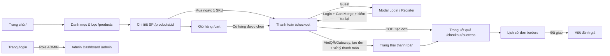

# Chạm Tech — User Flow UI (Đặc tả luồng giao diện)

**Phiên bản:** 1.1 · **Trạng thái:** Đề xuất thống nhất để Design/Frontend/Backend triển khai · **Cập nhật:** 28/10/2026

Tài liệu tóm tắt các luồng thao tác trên UI để cả team (Frontend, Backend, Design) dễ đọc, dễ thống nhất và bắt tay vào code nhanh.

**Nguyên tắc chung:** UI mô tả tương tác; Backend là nguồn dữ liệu chuẩn (source of truth) cho giá, tồn kho, voucher, trạng thái thanh toán/đơn hàng và quyền truy cập. Các hành động thay đổi dữ liệu cần kiểm tra ở server, không chỉ dựa vào trạng thái nút trên UI. Các phần được đánh dấu **Phase 2/3** vẫn thuộc scope tổng thể nhưng không bắt buộc trong MVP (xem mục 12).

---

## 1. Vai trò & Điều hướng tổng quan

| Vai trò | Phạm vi | Mô tả ngắn |
| :--- | :--- | :--- |
| **Guest (Khách vãng lai)** | Toàn bộ Storefront công khai | Xem hàng, tìm kiếm, lọc cấu hình, so sánh, thêm giỏ hàng (lưu LocalStorage), chat với AI. |
| **Customer (Khách có nick)** | Storefront + Trang cá nhân | Giỏ hàng đồng bộ server, áp mã voucher, thanh toán đặt hàng, theo dõi đơn, hủy đơn mới tạo, viết review. |
| **Admin (Quản trị viên)** | `/admin/*` | Xem doanh thu/tồn kho, xử lý đơn và đối soát thanh toán, thêm/sửa sản phẩm & SKU, kiểm duyệt review, tạo voucher, bật/tắt cổng thanh toán. |

### Sơ đồ điều hướng chính



> **Lưu ý:** `/checkout/success` xác nhận **đơn đã được tạo**, không mặc định có nghĩa **đã thanh toán**. Màn hình phải hiển thị rõ trạng thái thanh toán thực tế.

---

## 2. Luồng Xác thực (Auth)

> **Thống nhất cho MVP:** Chỉ dùng **Username & Password** để đăng ký/đăng nhập; không yêu cầu OTP hay xác thực email. Luồng tự phục hồi mật khẩu chưa thuộc MVP; không được giả định email đã được xác thực.

### 2.1. Đăng nhập (Login)
- **Vị trí kích hoạt:**
  - Bấm "Đăng nhập" ở Header $\rightarrow$ Mở **Modal đăng nhập** ngay trên trang hiện tại (không làm mất ngữ cảnh đang lướt hàng).
  - Hoặc truy cập trực tiếp URL `/login` (Trang riêng biệt).
- **Form gồm:** `Username`, `Password`, checkbox `"Ghi nhớ"`, nút `[Đăng nhập]`, link `"Chưa có tài khoản? Đăng ký"`.
- **Hành vi & Phản hồi UI:**
  - Bấm submit $\rightarrow$ Nút xoay spinner, khóa input.
  - Thành công (Customer): Đóng modal, hiển thị Toast xanh `"Đăng nhập thành công"`, Header đổi sang Avatar + Tên; nếu đang checkout thì tiếp tục đúng luồng trước khi login.
  - Nếu có giỏ hàng Guest: gọi API **Cart Merge** và chờ kết quả trước khi vào checkout (quy tắc ở mục 4); khi có thay đổi tồn kho/giá phải thông báo khách.
  - Phân quyền: Nếu role là `ADMIN` $\rightarrow$ Chuyển về `/admin`; không tự động gộp giỏ Guest vào tài khoản Admin.
  - Thất bại (sai pass/user): Hiện lỗi xác thực chung, không tiết lộ username có tồn tại hay không; hiển thị lỗi ngay dưới form. Shake effect chỉ là tùy chọn, không thay thế thông báo chữ.
  - Session hết hạn khi ở trang cần login: mở lại Auth Modal, giữ lựa chọn giỏ hàng và dữ liệu form không nhạy cảm; thử lại hành động khi xác thực thành công. Chặn `/checkout`, `/orders/*`, `/admin/*` bằng **route guard + kiểm tra quyền tại Backend**.

### 2.2. Đăng ký (Register)
- **Vị trí:** Chuyển tab trên Modal Auth hoặc truy cập `/register`.
- **Form gồm:** `Tên hiển thị` (tùy chọn), `Username`, `Mật khẩu`, `Xác nhận mật khẩu`.
- **Hành vi UI:**
  - Kiểm tra trực tiếp: username $\ge$ 4 ký tự, mật khẩu tối thiểu 8 ký tự, mật khẩu xác nhận khớp; hiển thị lỗi tại trường tương ứng.
  - Username trùng: báo `"Tên đăng nhập đã được sử dụng"`; lỗi mạng/server: hiển thị thông báo và cho phép thử lại, không tạo tài khoản hai lần.
  - Bấm `[Đăng ký]` $\rightarrow$ Tạo tài khoản thành công $\rightarrow$ Tự động đăng nhập, gộp giỏ Guest (nếu có) rồi đóng modal. Nếu đang mua hàng, tiếp tục luồng checkout.

### 2.3. Đăng xuất (Logout)
- Bấm vào Avatar góc phải Header $\rightarrow$ Menu dropdown $\rightarrow$ Chọn `"Đăng xuất"`.
- Xóa token/session, cache thông tin cá nhân/đơn hàng và giỏ server khỏi thiết bị; không hiển thị giỏ của tài khoản cũ cho Guest hoặc tài khoản đăng nhập sau đó.
- Nếu đang ở trang riêng tư (`/admin/*`, `/orders/*`, `/checkout`) $\rightarrow$ Đẩy về Trang chủ `/`.

---

## 3. Tìm kiếm, Danh mục & So sánh sản phẩm

### 3.1. Tìm kiếm nhanh (Autocomplete)
- Khách gõ vào thanh Search trên Header:
  - Gõ $\ge$ 2 ký tự (debounce 300ms) $\rightarrow$ Mở dropdown gợi ý ngay dưới ô search.
  - Dropdown hiển thị: 4-5 sản phẩm khớp nhất (Ảnh nhỏ, tên in đậm từ khóa, giá từ...) + dòng `"Xem tất cả kết quả cho '...'"` ở dưới cùng.
  - Bấm vào 1 sản phẩm $\rightarrow$ Chuyển thẳng sang trang Chi tiết. Bấm Enter hoặc `"Xem tất cả"` $\rightarrow$ Sang trang `/products?search=...`.
  - Nếu không khớp sản phẩm: hiển thị `"Không tìm thấy sản phẩm"` và đường dẫn xem toàn bộ; nếu request mới hơn hoàn tất trước request cũ thì chỉ hiển thị kết quả của từ khóa hiện tại.

### 3.2. Lọc danh mục & Thông số kỹ thuật (`/products`)
- **Sidebar trái:**
  - Hãng sản xuất (Apple, Asus, Dell, Samsung...) - chọn nhiều hãng cùng lúc.
  - Khoảng giá: Nút chọn nhanh (< 10tr, 10-20tr, > 20tr) hoặc thanh kéo slider.
  - **Thông số động theo danh mục:**
    - Với Laptop: RAM (8GB, 16GB, 32GB), CPU (Core i5, i7, Apple M3).
    - Với Điện thoại: Dung lượng (128GB, 256GB, 512GB), 5G.
- **Khu vực hiển thị (Phải):**
  - Thanh toolbar trên: Đếm số lượng kết quả, danh sách chip lọc đang chọn (bấm `✕` để gỡ), dropdown sắp xếp (Giá tăng/giảm, Bán chạy, Mới nhất).
  - Khi đổi bộ lọc $\rightarrow$ Hiện Skeleton loading mờ nhẹ (không giật giật layout).
  - URL đồng bộ query param (`?category=laptop&ram=16gb`) để reload không mất lọc.
  - Nếu không có kết quả: hiển thị empty state, nút `[Xóa bộ lọc]`; bộ lọc không hợp lệ trong URL được bỏ qua an toàn.

### 3.3. Xem chi tiết & Chọn biến thể SKU (`/products/:id`)
- **Chọn phiên bản (Màu sắc & Cấu hình):**
  - Màu sắc: Swatch tròn thể hiện màu thực tế + tên màu.
  - Cấu hình (RAM / Ổ cứng): Dạng chip bấm chữ nhật (VD: `256GB - 28.490.000₫`).
  - Khi click đổi cấu hình/màu $\rightarrow$ Giá bán, ảnh to và trạng thái kho cập nhật ngay lập tức. Mỗi tổ hợp màu/cấu hình hợp lệ là **một SKU**; biến thể không tồn tại phải bị disabled (không tự chọn SKU khác âm thầm).
- **Tình trạng hàng & Nút mua:**
  - Còn hàng: Nút `[THÊM VÀO GIỎ]` (thêm ngầm, nảy icon giỏ) và `[MUA NGAY]` (chỉ checkout **SKU và số lượng đang chọn**, không tự thêm toàn bộ giỏ cũ vào đơn).
  - Hết hàng (`stock = 0`): Ẩn/disable nút mua và hiển thị `[Báo khi có hàng]` (**Phase 3**). Bấm mở form nhập email đăng ký thông báo; nhập email là hành vi opt-in riêng, không đồng nghĩa xác thực tài khoản. Hiển thị xác nhận khi đăng ký thành công.
  - Khi thêm giỏ thất bại (hết hàng/đổi giá/lỗi mạng): không nảy số giả; hiển thị thông báo và giá/tồn kho mới từ server.

### 3.4. So sánh thông số (2–3 sản phẩm, Phase 2)
```
[Checkbox (+ So sánh) ở card SP] 
       ↓ 
[Hiện Floating Bar ở đáy màn hình: "Đã chọn 2/3 sản phẩm"] 
       ↓ 
[Bấm "So sánh ngay"] 
       ↓ 
[Mở Modal 85% màn hình: Bảng ma trận so sánh các dòng thông số, highlight dòng khác biệt]
```
- Chỉ cho phép so sánh các máy trong **cùng danh mục** (Laptop so với Laptop).
- Trên Modal so sánh có nút `[✕ Bỏ]` để xóa bớt máy và thêm máy khác.
- Chỉ bật nút `[So sánh ngay]` khi đã chọn **2–3 sản phẩm**; khi chọn sản phẩm thứ tư hoặc khác danh mục, hiện lý do không thể thêm. Trên mobile dùng trang/sheet toàn màn hình và cuộn ngang bảng thông số.

---

## 4. Giỏ hàng & Đồng bộ (Cart)

- **Thêm vào giỏ:**
  - Guest $\rightarrow$ Lưu `localStorage` theo `skuId` + `quantity`; cập nhật số lượng trên icon giỏ.
  - Customer $\rightarrow$ Gọi API lưu server; server kiểm tra SKU có bán và tồn kho trước khi trả kết quả.
  - Cùng `skuId` trong một giỏ chỉ có **một dòng**, thêm lại thì tăng số lượng. Một sản phẩm có màu/RAM khác nhau là SKU khác nhau.
- **Trang Giỏ hàng (`/cart`):**
  - Danh sách hàng có checkbox chọn từng món hoặc `"Chọn tất cả"`; chỉ **những SKU đang chọn** mới đi vào checkout.
  - Tăng/giảm số lượng `[-] [ 1 ] [+]`; không cho số lượng < 1 hoặc > tồn kho mới nhất. Khi hết hàng hoặc ngừng bán, gắn nhãn `"Không thể đặt"` và yêu cầu khách bỏ SKU đó hoặc chỉnh số lượng.
  - Cột tóm tắt: Tổng tạm tính chỉ của các món được tick; nếu không tick món nào thì disable `[Tiến hành đặt hàng]` và nhắc chọn ít nhất một món.
  - Bấm `[Tiến hành đặt hàng]`: Guest $\rightarrow$ Auth Modal; Customer $\rightarrow$ `/checkout`. Sau khi login, danh sách SKU đã tick được giữ lại nếu còn hợp lệ.
  - Sản phẩm không được chọn **vẫn nằm trong giỏ** sau khi đặt đơn; chỉ xóa các SKU và số lượng đã mua thành công.

### 4.1. Quy tắc Cart Merge khi Guest đăng nhập/đăng ký
1. Gộp theo `skuId`: nếu trùng với giỏ server thì cộng số lượng, **không tạo hai dòng trùng**.
2. Nếu tổng vượt tồn kho, giới hạn về số lượng còn bán được và hiển thị thông báo dạng `"Sản phẩm A chỉ còn N chiếc"`; không tự động làm phát sinh đơn hàng.
3. SKU đã hết hàng/ngừng bán vẫn được đánh dấu cần xử lý (không lặng lẽ xóa); không cho checkout SKU không hợp lệ.
4. Giữ lựa chọn SKU đang tick nếu vẫn hợp lệ; nếu một SKU bị loại khỏi danh sách checkout, hiển thị tóm tắt để khách xác nhận lại.
5. Sau khi merge **thành công** mới xóa giỏ Guest trong `localStorage`; nếu API lỗi, giữ dữ liệu cục bộ để thử lại. Request merge cần có khóa chống xử lý lặp.

### 4.2. Kiểm tra trước khi tạo đơn
- Khi mở checkout và ngay trước khi xác nhận, server trả **giá, số lượng khả dụng, trạng thái SKU, phí vận chuyển, voucher và tổng tiền cuối cùng**. Nếu có khác biệt, hiện thay đổi và yêu cầu khách xác nhận lại; không tự đặt theo giá cũ.
- Việc kiểm tra tồn kho trong UI **không thay thế** kiểm tra nguyên tử ở Backend khi tạo đơn. API tạo đơn phải có `idempotencyKey` để một lượt xác nhận không tạo hai đơn dù người dùng click lại hoặc gửi lại request.

---

## 5. Thanh toán đơn trang (Single-Page Checkout `/checkout`)

> **Thiết kế:** Desktop dùng **1 trang chia 2 cột**, cột phải sticky; mobile hiển thị một cột và tổng tiền/nút CTA dễ truy cập. Chỉ Customer đã đăng nhập mới xác nhận đặt hàng. Hình và số tiền dưới đây là **minh họa**, không phải giá/phí mặc định.

```
+----------------------------------------------------+--------------------------------+
| CỘT TRÁI: THÔNG TIN GIAO NHẬN & THANH TOÁN         | CỘT PHẢI (STICKY): TỔNG KẾT    |
+----------------------------------------------------+--------------------------------+
| 1. HÌNH THỨC NHẬN HÀNG                             | Danh sách món chọn mua         |
| (•) Giao tận nơi: Chọn địa chỉ có sẵn hoặc [+ Mới] | iPhone 15 Pro Max  x1          |
| ( ) Nhận tại shop: Chọn chi nhánh từ dropdown      | Ốp lưng MagSafe    x1          |
|                                                    | ------------------------------ |
| 2. MÃ GIẢM GIÁ (VOUCHER)                           | Tạm tính:         29.180.000 ₫ |
| [Nhập mã...        ] [Áp dụng]                     | Phí giao hàng:        30.000 ₫ |
| > Báo xanh: Giảm 500k / Báo đỏ: Mã không hợp lệ    | Voucher giảm:       -500.000 ₫ |
|                                                    | ============================== |
| 3. PHƯƠNG THỨC THANH TOÁN                          | TỔNG CỘNG:        28.710.000 ₫ |
| (•) Tiền mặt khi nhận hàng (COD)                   |                                |
| ( ) Chuyển khoản qua mã VietQR                     | [ NÚT: XÁC NHẬN ĐẶT HÀNG ]     |
| ( ) Cổng thẻ / Ví điện tử (nếu được bật)           |                                |
+----------------------------------------------------+--------------------------------+
```

### 5.1. Giao nhận & kiểm tra form
- **Giao tận nơi:** Chọn địa chỉ đã lưu hoặc `[+ Thêm địa chỉ]`. Form gồm `Họ tên người nhận`, `Số điện thoại`, `Tỉnh/Thành`, `Phường/Xã`, `Số nhà/đường và địa chỉ cụ thể` và `Ghi chú` (tùy chọn); trường bắt buộc có lỗi ngay bên dưới nếu trống/sai định dạng. Cho phép chỉnh hoặc chọn địa chỉ khác mà không mất giỏ hàng.
- **Nhận tại shop:** Chọn chi nhánh từ danh sách **đang hoạt động**; yêu cầu tên và số điện thoại người nhận. Chỉ cho xác nhận nếu tất cả SKU của đơn khả dụng tại chi nhánh đã chọn. Nếu chưa có dữ liệu tồn kho theo chi nhánh, tạm ẩn tùy chọn này thay vì xác nhận sai; nếu không có chi nhánh phù hợp, hướng khách chuyển sang giao tận nơi/đổi chi nhánh.
- Chuyển phương thức nhận hàng $\rightarrow$ tính lại phí giao hàng và tính hợp lệ của voucher; với nhận tại shop, phí giao hàng bằng 0.
- **Voucher (Phase 2):** Backend kiểm tra hiệu lực, giá trị tối thiểu, lượt dùng và điều kiện áp dụng; hiển thị lý do nếu mã hết hạn/không hợp lệ. Voucher được kiểm tra lại khi tạo đơn, tổng tiền không thể âm.
- Phương thức thanh toán đang bị Admin tắt phải được disable kèm lý do; nếu bị tắt trong lúc khách checkout, yêu cầu chọn lại trước khi tạo đơn.

### 5.2. Xác nhận đặt hàng & trạng thái thanh toán

**Quy ước:** `OrderStatus` và `PaymentStatus` là **hai trường độc lập**.

| `PaymentStatus` | Ý nghĩa trên UI |
| :--- | :--- |
| `UNPAID` | Chưa ghi nhận thanh toán (bao gồm đơn COD chưa thu tiền). |
| `PENDING_VERIFICATION` | Khách báo đã chuyển khoản, hệ thống/chủ shop đang đối soát; **không đồng nghĩa đã trả tiền**. |
| `PAID` | Backend/Admin đã xác nhận thực nhận tiền hoặc cổng thanh toán trả kết quả hợp lệ. |
| `FAILED` | Giao dịch online thất bại; có thể thử lại trên **cùng đơn** nếu đơn còn hiệu lực. |
| `REFUND_PENDING` | Đơn đã hủy và khoản tiền đã thu đang chờ hoàn. |
| `REFUNDED` | Hoàn tiền đã được xác nhận. |

**Xử lý theo phương thức:**
1. **COD (MVP):** Backend kiểm tra dữ liệu và tạo đơn (`OrderStatus=PENDING`, `PaymentStatus=UNPAID`) $\rightarrow$ `/checkout/success?orderId=...`. Trang kết quả ghi `"Đặt hàng thành công — thanh toán khi nhận hàng"`. Admin xác nhận `PAID` sau khi đã thu tiền COD.
2. **VietQR (Phase 2):** Tạo đơn `PENDING/UNPAID` và QR chứa đúng **số tiền + mã đơn duy nhất** $\rightarrow$ hiện mã QR cùng hướng dẫn. Bấm `"Tôi đã chuyển khoản"` chỉ cập nhật `PENDING_VERIFICATION`; **không tự đặt `PAID`**. Chỉ Backend đối soát giao dịch hoặc Admin kiểm tra chứng từ/biến động ngân hàng mới xác nhận `PAID`. Trang kết quả phải hiện `"Đã ghi nhận đơn — đang xác minh thanh toán"` nếu chưa xác minh. Nút đóng QR không đồng nghĩa hủy đơn; có thể mở lại hướng dẫn thanh toán trong chi tiết đơn.
3. **Gateway (Phase 3):** Tạo đơn và mở giao diện thanh toán (giả lập chỉ trong môi trường demo). `PAID` chỉ khi Backend nhận kết quả xác thực hợp lệ từ cổng hoặc mock server, **không dựa vào URL redirect/client callback đơn thuần**. Thất bại: giữ đơn ở trạng thái cho phép thử lại nếu còn hiệu lực; không tạo đơn thứ hai.

**Quy tắc chung:**
- Sau khi tạo đơn, lưu snapshot `skuId`, giá và số lượng đã xác nhận. Backend trừ/giữ tồn kho **nguyên tử** khi tạo đơn và hoàn lại **đúng một lần** khi đơn bị hủy hợp lệ.
- Đối với đơn online chưa được xác nhận thanh toán, đặt hạn thanh toán (đề xuất **30 phút**, cấu hình ở Backend). Khi hết hạn mà chưa thanh toán hoặc đối soát, đánh dấu đơn hết hạn/hủy và giải phóng tồn kho; trường hợp chuyển tiền muộn/chưa đối soát thì chuyển xử lý thủ công, không tự coi là thành công. Đơn `PENDING_VERIFICATION` chuyển vào danh sách Admin phải đối soát trong thời hạn xử lý riêng (team cần chốt); không tự động hủy trước khi kiểm tra chuyển khoản và **không giữ tồn kho vô thời hạn**.
- Nếu form lỗi, tồn kho/giá thay đổi hoặc voucher không còn hợp lệ: **không tạo đơn**, thông báo rõ và cho khách cập nhật. Nếu mạng lỗi sau khi bấm xác nhận: có thể truy vấn bằng `idempotencyKey`/mã đơn để biết đã tạo hay chưa trước khi thử lại.
- `/checkout/success` chỉ hiển thị đơn thuộc tài khoản đang đăng nhập. Nếu thiếu `orderId` hoặc không có quyền xem, chuyển đến `/orders` hoặc trang lỗi phù hợp.

---

## 6. Đơn hàng & Đánh giá (Orders & Reviews)

### 6.1. Xem, chuyển trạng thái & Hủy đơn hàng
- **Danh sách đơn (`/orders`):** Lọc `[Tất cả]`, `[Chờ duyệt]`, `[Đang xử lý]` (CONFIRMED/PACKING), `[Đang giao]`, `[Đã giao]`, `[Đã hủy]`; mỗi đơn hiển thị **trạng thái giao hàng và thanh toán riêng**.
- **Chi tiết đơn (`/orders/:id`):** Có Stepper: `Đặt thành công` $\rightarrow$ `Đã duyệt` $\rightarrow$ `Đang đóng gói` $\rightarrow$ `Đang giao` $\rightarrow$ `Đã nhận hàng`. Với đơn hủy, hiển thị lý do, thời gian và trạng thái hoàn tiền thay vì tiếp tục Stepper.
- **Khách tự hủy:** Chỉ hiển thị `[Hủy đơn]` khi `OrderStatus=PENDING`. Popup chọn lý do $\rightarrow$ xác nhận $\rightarrow$ Backend kiểm tra lại trạng thái và cập nhật `CANCELLED`, trả tồn kho một lần. Nếu Admin vừa xác nhận đơn trước đó, báo `"Đơn đã được xử lý, không thể tự hủy"`, tải lại trạng thái.
- Nếu đã `CONFIRMED`, khách liên hệ hỗ trợ; không cho tự hủy bằng cách gọi API trực tiếp.

**Quy tắc trạng thái đơn hàng (Backend bắt buộc enforce):**

| Trạng thái hiện tại | Hành động hợp lệ | Trạng thái tiếp theo | Quyền |
| :--- | :--- | :--- | :--- |
| `PENDING` | Xác nhận đơn | `CONFIRMED` | Admin; COD có thể `UNPAID`, online phải `PAID` |
| `PENDING` | Hủy đơn | `CANCELLED` | Customer (đơn của mình) hoặc Admin |
| `CONFIRMED` | Đưa vào đóng gói | `PACKING` | Admin |
| `CONFIRMED` | Hủy theo yêu cầu hỗ trợ | `CANCELLED` | Admin, áp dụng kiểm tra hoàn tiền |
| `PACKING` | Bàn giao vận chuyển | `SHIPPING` | Admin |
| `SHIPPING` | Xác nhận đã giao | `DELIVERED` | Admin |
| `CANCELLED`, `DELIVERED` | Không có chuyển trạng thái thông thường | — | — |

- Không cho Admin xác nhận/đóng gói đơn chuyển khoản chưa `PAID`. Không cho hủy tự động đơn đã chuyển trạng thái thành `CONFIRMED`.
- Nếu hủy đơn đã `PAID`, tạo quy trình `REFUND_PENDING` $\rightarrow$ `REFUNDED` khi đã hoàn tiền; không đánh dấu đã hoàn khi mới yêu cầu hoàn. Số lượng được hoàn tồn kho đúng một lần, xử lý bằng giao dịch/khóa idempotent.
- Đơn hết hạn thanh toán online có thể kết thúc ở `CANCELLED` với `cancelReason=PAYMENT_EXPIRED`; việc đối soát chuyển tiền đến muộn phải được Admin xử lý riêng.

### 6.2. Viết đánh giá sản phẩm (Review, Phase 2)
- **Điều kiện:** Customer chỉ được đánh giá `orderItem` thuộc **đơn của chính mình** đã `DELIVERED`; tối đa **1 review / orderItem** (mua lại qua đơn khác được đánh giá lại).
- **Thao tác:** Bấm `[Viết đánh giá]` ở đơn hàng hoặc trang chi tiết sản phẩm $\rightarrow$ Mở Modal:
  - Chọn 1–5 sao (hover đổi màu vàng; hỗ trợ chọn qua bàn phím).
  - Gõ bình luận trải nghiệm (tối thiểu 10 ký tự sau trim).
  - Chọn ảnh tải lên (tối đa 5 ảnh; chỉ nhận định dạng và dung lượng được Backend cho phép), có nút `✕` để xóa trước khi gửi.
  - Bấm gửi $\rightarrow$ Toast cảm ơn $\rightarrow$ Review hiển thị ngay trên trang chi tiết sản phẩm theo mô hình **hậu kiểm** (`VISIBLE`). Nếu upload/thao tác lỗi, giữ nội dung đã nhập và cho thử lại.
- **Báo cáo review:** Customer đã đăng nhập có thể bấm `"Báo cáo"` và chọn lý do; chặn báo cáo trùng cho cùng người dùng và review. Review vẫn `VISIBLE` cho đến khi Admin ẩn. Trạng thái `REPORTED` là **cờ báo cáo**, không phải trạng thái duyệt.
- **Admin kiểm duyệt:** Có thể chuyển `VISIBLE` $\leftrightarrow$ `HIDDEN`; xóa vĩnh viễn cần popup xác nhận. Không dùng trạng thái `ĐÃ DUYỆT` nếu không có quy trình tiền kiểm.

---

## 7. Trợ lý AI (Product Advisor Chatbot)

> **Mô hình hoạt động:** Drawer trượt từ cạnh phải (380px trên desktop), mở bằng icon robot góc dưới phải; mobile dùng panel toàn màn hình hoặc gần toàn màn hình. AI chỉ được thao tác qua API có phân quyền và dữ liệu sản phẩm thực tế; lời chat không phải bằng chứng tồn kho/giá.

### 3 tính năng chính của Trợ lý AI trên UI
1. **Tư vấn bằng ngôn ngữ đời thường (Phase 2):**
   - Khách gõ: *"Tìm laptop văn phòng mỏng nhẹ pin trâu tầm 20 củ"*.
   - AI trả lời tóm tắt dễ hiểu + hiển thị **thanh trượt thẻ sản phẩm mini** (ảnh, tên, giá, nút xem nhanh). Các thẻ lấy từ catalog/backend, không được tự tạo giá hoặc SKU không tồn tại.
   - Không có sản phẩm đáp ứng: thông báo và gợi ý thay đổi ngân sách/bộ lọc, thay vì bịa kết quả.
2. **Hành động mua sắm tự động (AI Shopping Action, Phase 3):**
   - Khách gõ: *"Thêm con Asus ở trên vào giỏ hàng giúp mình"*.
   - Nếu máy có nhiều biến thể, hiện lựa chọn **màu, cấu hình/SKU, số lượng** trước. AI hiển thị card xác nhận `"ASUS Vivobook 14 — [SKU] — [giá hiện tại]"`.
   - Chỉ khi khách bấm `[Thêm ngay]` mới gọi API/cart action; Backend xác nhận tồn kho/giá rồi cập nhật icon giỏ. Nếu lỗi/thiếu biến thể/đổi giá, báo rõ và giữ tương tác để người dùng chọn lại.
   - AI không tự đặt đơn, không tự thanh toán, không thực hiện hành động nhạy cảm chỉ dựa vào câu trả lời văn bản.
3. **Tra cứu đơn & Hàng về (Phase 3):**
   - Khách hỏi: *"Đơn hàng hôm qua của mình đến đâu rồi?"* $\rightarrow$ Nếu chưa đăng nhập, yêu cầu login. Chỉ trả về **đơn thuộc tài khoản đang đăng nhập**, kiểm tra quyền tại Backend; nếu nhiều đơn phù hợp, cho khách chọn.
   - Nếu hỏi sản phẩm hết hàng $\rightarrow$ AI đưa nút `[Đăng ký nhận tin khi có hàng]`, chỉ lưu email sau khi khách xác nhận opt-in.

- **Trạng thái lỗi:** Hiển thị khi AI không phản hồi, API sản phẩm thất bại hoặc mất kết nối; có `[Thử lại]` và link sang trang sản phẩm/đơn hàng để khách tự thao tác. Không tuyên bố hành động đã thành công khi Backend chưa xác nhận.

---

## 8. Quản trị cửa hàng (Admin Back-office `/admin/*`)

> Đăng nhập qua `/login` bằng tài khoản Admin $\rightarrow$ Tự chuyển sang `/admin`. Giao diện có Sidebar menu bên trái.

| Màn hình | Thao tác chính trên UI |
| :--- | :--- |
| **Dashboard (`/admin`)** | 4 thẻ số liệu chính (Doanh thu hôm nay, Đơn mới, SKU sắp hết hàng, Đơn đang xử lý) + Bảng cảnh báo SKU có tồn kho < 5 chiếc. |
| **Quản lý Sản phẩm (`/admin/products`)** | Bảng danh sách, nút switch Bật/Tắt hiển thị SP. Modal thêm/sửa gồm: Thông tin cơ bản $\rightarrow$ Bảng ma trận biến thể SKU (Màu, RAM, Giá, Tồn kho) $\rightarrow$ Thêm nhóm thông số kỹ thuật. |
| **Quản lý Đơn hàng (`/admin/orders`)** | Xem/lọc đơn theo `OrderStatus` và `PaymentStatus`; drawer chi tiết hiển thị phương thức thanh toán, đối soát VietQR, lịch sử chuyển trạng thái; chỉ hiện các action hợp lệ theo bảng mục 6.1, có xác nhận khi hủy/hoàn tiền. |
| **Kiểm duyệt Đánh giá (`/admin/reviews`)** | Tab `[HIỂN THỊ]`, `[BỊ BÁO CÁO]` (lọc review có cờ report), `[ĐÃ ẨN]`; nút `Ẩn`, `Hiện lại`, `Xóa vĩnh viễn` (có xác nhận). Mô hình hậu kiểm, không có trạng thái `ĐÃ DUYỆT`. |
| **Mã Khuyến mãi (`/admin/vouchers`)** | Bảng danh sách mã, thanh tiến độ số lượt đã dùng. Modal tạo voucher: Mã, Loại (% hay tiền cố định), Giá trị đơn tối thiểu, Giới hạn lượt dùng, Ngày bắt đầu - hết hạn. |
| **Cài đặt Cửa hàng (`/admin/settings`)** | Quản lý banner (ảnh/link/thứ tự); bật/tắt COD, VietQR, Gateway theo feature flag; quản lý chi nhánh đang hoạt động và khả năng nhận hàng. Các thay đổi phải được checkout áp dụng theo dữ liệu mới nhất. |

Khi sửa/xóa SKU ở Admin, phải kiểm tra trùng SKU và không làm mất thông tin lịch sử của các đơn đã đặt (đơn luôn đọc snapshot giá/tên/SKU tại lúc mua).

---

## 9. Phản hồi giao diện & Xử lý lỗi (Quick UI States)

- **Loading:** Skeleton cho vùng dữ liệu đang tải (catalog, product, order, dashboard); spinner nhỏ trong nút submit. Không dùng spinner che toàn màn hình nếu vẫn có thể xem nội dung cũ.
- **Submit:** Disable nút trong lúc request đang xử lý; Backend vẫn dùng **idempotency/transaction** chống tạo đơn/hành động lặp, không chỉ dựa vào nút disabled.
- **Thông báo:** Toast ở góc trên phải với thành công/lỗi ngắn (có thể tự tắt sau 4 giây); lỗi nhập form, thanh toán chờ xác minh và lỗi quan trọng cần **text inline/banner còn hiển thị**, không phụ thuộc vào toast màu sắc.
- **Hết hàng:** Card sản phẩm phủ xám nhẹ, ghi `"Tạm hết hàng"`; không cho đặt SKU không có tồn kho.
- **Giỏ hàng rỗng:** Minh họa + `[Tiếp tục mua sắm]` về `/products`.
- **Không có kết quả:** Danh mục/search hiển thị từ khóa, chip lọc và `[Xóa bộ lọc]` hoặc `[Xem tất cả sản phẩm]`.
- **Không có đơn/review:** Hiển thị empty state có hướng dẫn hành động tiếp theo.
- **Lỗi kết nối/timeout:** Hiện `[Thử lại]`, giữ dữ liệu form và trạng thái lựa chọn; với checkout phải kiểm tra đơn đã tạo hay chưa trước khi gửi lại.
- **Unauthorized/Forbidden:** Guest đến trang riêng tư $\rightarrow$ login; Customer vào `/admin/*` hoặc xem đơn của người khác $\rightarrow$ trang 403/404 phù hợp (Backend bắt buộc trả lỗi quyền).

---

## 10. Responsive & Accessibility

| Khu vực | Desktop | Mobile |
| :--- | :--- | :--- |
| Catalog filter | Sidebar trái | Nút `Bộ lọc` mở bottom sheet/drawer, có `Áp dụng` và `Xóa lọc` |
| Product detail | Ảnh và chọn SKU cạnh nhau | Ảnh phía trên, chọn SKU và CTA dễ chạm; không che lựa chọn biến thể |
| Cart/Checkout | Danh sách trái, tổng kết phải sticky | Một cột; tổng tiền và CTA hiển thị rõ, tránh che nội dung/input |
| Product compare | Modal 85% màn hình | Full-screen sheet/page, bảng cuộn ngang và cột tên thuộc tính dễ đọc |
| AI Assistant | Drawer rộng khoảng 380px | Panel toàn màn hình, có nút đóng rõ ràng |
| Admin | Sidebar điều hướng | Sidebar thu gọn; bảng dài có cuộn ngang hoặc card thay thế |

- Modal/drawer quản lý **keyboard focus** (focus trap), đóng được bằng Escape khi an toàn, trả focus về nút mở; hành động gây mất dữ liệu có bước xác nhận.
- Các trường input có `label`, thông báo lỗi bằng chữ, trạng thái disabled rõ ràng; các nút icon có tên truy cập (accessible name). Màu sắc không phải tín hiệu duy nhất.
- Ưu tiên vùng chạm đủ lớn trên mobile, nội dung không bị bàn phím che khuất, bàn phím không gây submit nhầm.

---

## 11. Acceptance Criteria — Các tình huống phải test

| ID | Tình huống | Kết quả mong đợi |
| :--- | :--- | :--- |
| AC-01 | Guest có 2 SKU, login vào Customer có 1 SKU trùng | Giỏ server gộp theo `skuId`, không có dòng trùng; số lượng không vượt tồn kho; có thông báo nếu phải điều chỉnh |
| AC-02 | API Cart Merge lỗi | Giữ giỏ Guest; cho thử lại, không mất món/không merge lặp |
| AC-03 | Giỏ không tick SKU nào | Nút checkout bị disable, có lời nhắc chọn món |
| AC-04 | SKU hết hàng hoặc thay giá khi đang checkout | Không tạo đơn theo giá/số lượng cũ; hiển thị dữ liệu mới và yêu cầu xác nhận lại |
| AC-05 | Nhấn xác nhận đơn hai lần hoặc request timeout rồi retry | Backend chỉ tạo **một** đơn cho cùng `idempotencyKey` |
| AC-06 | Guest vào `/checkout` / Customer vào `/admin` | Yêu cầu login / từ chối truy cập tương ứng; Backend không trả dữ liệu trái quyền |
| AC-07 | COD tạo đơn thành công | `PENDING + UNPAID`; trang kết quả ghi thanh toán khi nhận hàng |
| AC-08 | VietQR: khách bấm `Tôi đã chuyển khoản` mà chưa đối soát | Chỉ `PENDING_VERIFICATION`, **không** là `PAID` |
| AC-09 | Gateway thất bại, thử lại | Hiện lỗi; thử lại trên cùng đơn còn hiệu lực, không tạo đơn thứ hai |
| AC-10 | Customer hủy đơn `PENDING` đúng lúc Admin xác nhận | Chỉ một chuyển trạng thái thắng; còn lại nhận lỗi xung đột, không hoàn kho hai lần |
| AC-11 | Hủy đơn đã thanh toán | Ghi `REFUND_PENDING`, chỉ `REFUNDED` sau khi xác nhận hoàn tiền |
| AC-12 | Customer review đơn chưa giao hoặc của người khác | Backend từ chối; cùng `orderItem` không tạo review trùng |
| AC-13 | Review bị báo cáo | Review vẫn hiện cho đến khi Admin ẩn; tab báo cáo lọc theo cờ `REPORTED` |
| AC-14 | AI được yêu cầu thêm sản phẩm nhiều SKU | Hiển thị chọn SKU/số lượng và card xác nhận; chỉ thêm khi khách bấm và Backend đồng ý |
| AC-15 | AI tra cứu đơn không thuộc tài khoản hiện tại | Không tiết lộ trạng thái/thông tin đơn, kể cả khi biết `orderId` |
| AC-16 | Trên mobile mở filter, compare, checkout và chat AI | Không có nội dung bị cắt; thao tác và nút xác nhận dùng được bằng chạm |

---

## 12. Phạm vi phát triển (đề xuất theo giai đoạn)

> Phân phase để team dễ chia task; **không xóa** các tính năng trong user flow tổng thể. Các mục ở Phase 2/3 chỉ triển khai khi MVP ổn định hoặc theo ưu tiên của team.

| Giai đoạn | Chức năng |
| :--- | :--- |
| **MVP (Phase 1)** | Auth, Catalog/Search/Filter, Product/SKU, Cart & Merge, COD Checkout (giao tận nơi; nhận tại shop chỉ khi có dữ liệu kho chi nhánh), Order Tracking/Cancellation, Admin Products/Orders, responsive cơ bản, kiểm tra quyền và edge cases |
| **Phase 2** | Voucher, so sánh sản phẩm, Reviews/Reports, VietQR + quy trình đối soát có thật (hoặc thủ công), AI tư vấn sản phẩm từ catalog |
| **Phase 3** | AI Shopping Action, AI tra cứu đơn, báo hàng về qua email, payment gateway, banner/store settings nâng cao |

**Điều kiện mở rộng:** Nếu AI advisor là mục tiêu trình diễn chính, có thể đưa **AI tư vấn sản phẩm (read-only)** lên MVP; vẫn giữ AI thêm giỏ/tra cứu đơn là bước sau để tránh tăng rủi ro tích hợp.

---

## 13. Những quyết định cần team xác nhận trước khi code

1. **VietQR:** Có webhook/đối soát tự động hay Admin đối soát thủ công? Không triển khai trạng thái `PAID` dựa vào nút người mua bấm.
2. **Tồn kho & thanh toán online:** Quy tắc giữ hàng, thời gian hết hạn (đề xuất 30 phút), và quy trình xử lý chuyển khoản muộn/đang đối soát.
3. **Phí ship & chi nhánh:** Công thức tính phí và dữ liệu tồn kho theo chi nhánh là hệ thống thật hay demo. Nếu demo, UI phải ghi rõ quy tắc mô phỏng.
4. **Khôi phục mật khẩu:** Chưa thuộc MVP; nếu dùng tài khoản thật cần thiết kế phương thức khôi phục an toàn, không dùng mật khẩu mặc định hoặc tiết lộ mật khẩu.
5. **Phase:** Team chốt tính năng nào bắt buộc phải demo trong deadline; có thể chuyển AI advisor read-only lên MVP nếu đây là điểm nhấn của đề tài.
