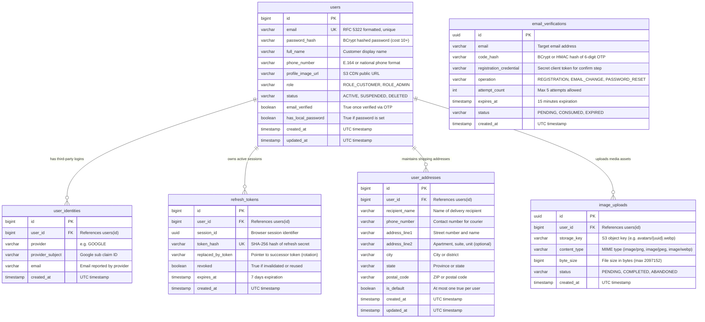
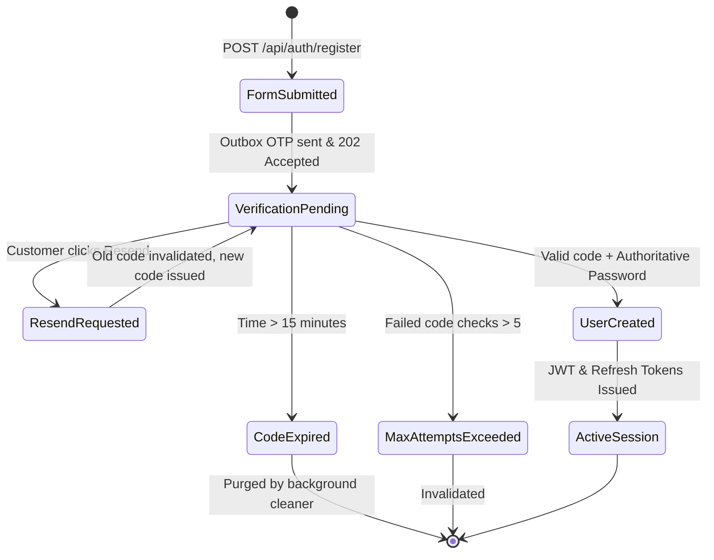
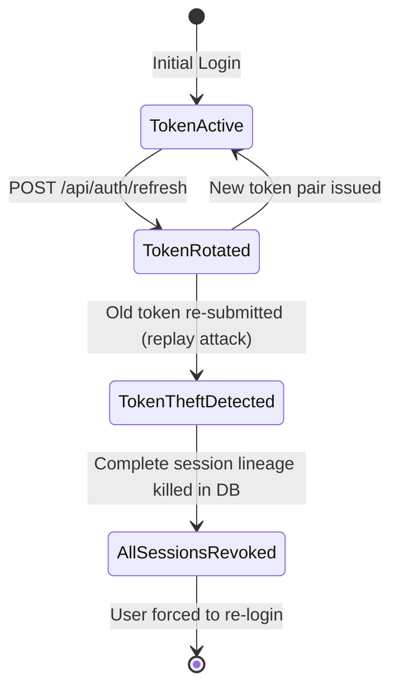

# Data Model: Authentication & User Profile Management

**Feature**: `001-auth-user-profile-management`  
**Database**: PostgreSQL 17  
**Schema Versioning**: Flyway Migrations (V1..V14)  
**Date**: 2026-11-04  

---

## 1. Entity-Relationship Diagram



---

## 2. Table Specifications & DDL Definitions

### 2.1 `users` Table
Stores primary user accounts and core profile information.

```sql
CREATE TABLE users (
    id BIGSERIAL PRIMARY KEY,
    email VARCHAR(255) NOT NULL UNIQUE,
    password_hash VARCHAR(255),
    full_name VARCHAR(150),
    phone_number VARCHAR(30),
    profile_image_url VARCHAR(500),
    role VARCHAR(50) NOT NULL DEFAULT 'ROLE_CUSTOMER',
    status VARCHAR(50) NOT NULL DEFAULT 'ACTIVE',
    email_verified BOOLEAN NOT NULL DEFAULT FALSE,
    has_local_password BOOLEAN NOT NULL DEFAULT TRUE,
    created_at TIMESTAMP WITH TIME ZONE NOT NULL DEFAULT CURRENT_TIMESTAMP,
    updated_at TIMESTAMP WITH TIME ZONE NOT NULL DEFAULT CURRENT_TIMESTAMP
);

CREATE INDEX idx_users_email ON users(email);
CREATE INDEX idx_users_status ON users(status);
```

### 2.2 `email_verifications` Table
Holds ephemeral one-time passcode challenges for registrations and email changes.

```sql
CREATE TABLE email_verifications (
    id UUID PRIMARY KEY DEFAULT gen_random_uuid(),
    email VARCHAR(255) NOT NULL,
    code_hash VARCHAR(255) NOT NULL,
    registration_credential VARCHAR(255) NOT NULL,
    operation VARCHAR(50) NOT NULL DEFAULT 'REGISTRATION',
    attempt_count INT NOT NULL DEFAULT 0,
    status VARCHAR(30) NOT NULL DEFAULT 'PENDING',
    expires_at TIMESTAMP WITH TIME ZONE NOT NULL,
    created_at TIMESTAMP WITH TIME ZONE NOT NULL DEFAULT CURRENT_TIMESTAMP
);

CREATE INDEX idx_verifications_email_status ON email_verifications(email, status);
CREATE INDEX idx_verifications_credential ON email_verifications(registration_credential);
CREATE INDEX idx_verifications_expires_at ON email_verifications(expires_at);
```

### 2.3 `refresh_tokens` Table
Tracks active refresh tokens, supporting token rotation and theft detection.

```sql
CREATE TABLE refresh_tokens (
    id BIGSERIAL PRIMARY KEY,
    user_id BIGINT NOT NULL REFERENCES users(id) ON DELETE CASCADE,
    session_id UUID NOT NULL,
    token_hash VARCHAR(255) NOT NULL UNIQUE,
    replaced_by_token VARCHAR(255),
    revoked BOOLEAN NOT NULL DEFAULT FALSE,
    expires_at TIMESTAMP WITH TIME ZONE NOT NULL,
    created_at TIMESTAMP WITH TIME ZONE NOT NULL DEFAULT CURRENT_TIMESTAMP
);

CREATE INDEX idx_refresh_tokens_user ON refresh_tokens(user_id);
CREATE INDEX idx_refresh_tokens_hash ON refresh_tokens(token_hash);
CREATE INDEX idx_refresh_tokens_session ON refresh_tokens(session_id);
```

### 2.4 `user_addresses` Table
Stores customer delivery addresses. Enforces maximum of one default address per customer.

```sql
CREATE TABLE user_addresses (
    id BIGSERIAL PRIMARY KEY,
    user_id BIGINT NOT NULL REFERENCES users(id) ON DELETE CASCADE,
    recipient_name VARCHAR(150) NOT NULL,
    phone_number VARCHAR(30) NOT NULL,
    address_line1 VARCHAR(255) NOT NULL,
    address_line2 VARCHAR(255),
    city VARCHAR(100) NOT NULL,
    state VARCHAR(100) NOT NULL,
    postal_code VARCHAR(30) NOT NULL,
    is_default BOOLEAN NOT NULL DEFAULT FALSE,
    created_at TIMESTAMP WITH TIME ZONE NOT NULL DEFAULT CURRENT_TIMESTAMP,
    updated_at TIMESTAMP WITH TIME ZONE NOT NULL DEFAULT CURRENT_TIMESTAMP
);

CREATE INDEX idx_user_addresses_user ON user_addresses(user_id);
```

---

## 3. Lifecycle & State Machines

### 3.1 Registration State Flow


### 3.2 Refresh Token Rotation & Theft Detection

