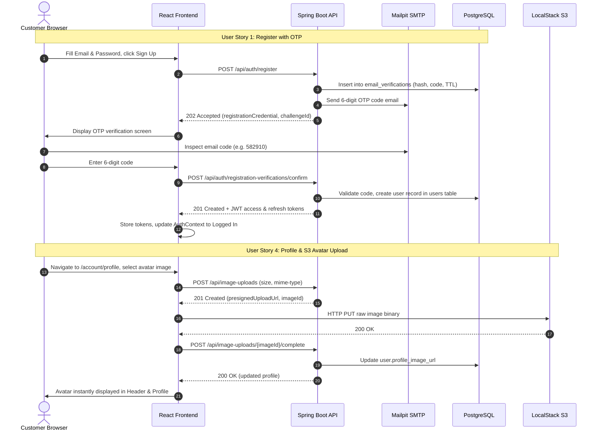

# Implementation Plan: Authentication and User Profile Management

**Branch**: `feature/user-profile-management` | **Date**: 2026-11-05 | **Spec**: [spec.md](spec.md)  
**Input**: Feature specification from `specs/001-auth-user-profile-management/spec.md`  
**Performed by**: Trịnh Văn Thành (Backend & DB), Phan Thị Thanh Huyền (Frontend)  

---

## Summary

Implement an end-to-end, production-ready Authentication and User Profile Management functional group across the complete technology stack: React frontend with Vite, Java Spring Boot modular-monolith backend, PostgreSQL database with Flyway migrations, Mailpit SMTP testing server, and LocalStack S3 for avatar image storage.

The architecture enforces a strict specification-driven workflow:
1. **Registration & OTP**: Initiation writes only an encrypted temporary challenge to `email_verifications` and dispatches a 6-digit code via Mailpit. Only authoritative confirmation with password creates the user in PostgreSQL and issues tokens.
2. **Session Security**: Stateless short-lived JWT access tokens (15 mins) accompanied by database-tracked rotating refresh tokens (7 days) with reuse detection.
3. **Google OAuth2**: Authorization Code Flow with PKCE and state correlation cookie.
4. **Profile & Avatar**: User profile updates (`/api/me`) with direct-to-S3 avatar upload via pre-signed PUT URLs.
5. **Address Book**: Comprehensive CRUD operations for shipping destinations with atomic single-default enforcement.

---

## Technical Context

**Language/Version**:
- Frontend: JavaScript / React 18, Node.js 18+
- Backend: Java 25 / Java 21, Maven 3.9+

**Primary Dependencies**:
- Frontend: Vite, React Router v6, TanStack Query, Axios, Lucide Icons, Custom CSS Modules
- Backend: Spring Boot 3.x / 4.x, Spring Security 6, Spring Data JPA, Hibernate, Flyway, Lombok, Nimbus JOSE JWT, Spring Mail

**Storage**:
- PostgreSQL 17 (relational database for users, identities, addresses, refresh tokens, verifications)
- LocalStack S3 (object storage bucket `backend-images` for avatars)
- Mailpit (SMTP server on 1025, web UI on 8025 for email verification codes)

**Testing**:
- Frontend: Node.js test runner (`npm test` — 38 tests), Playwright Chromium headless smoke (`browser-smoke.mjs` — 14 steps, `browser-regressions.mjs` — 10 scenarios)
- Backend: JUnit 5, Mockito, AssertJ, MockMvc, PostgreSQL Testcontainers

**Target Platform**:
- Web application (Chrome, Firefox, Safari, Edge); Docker Compose containerized local development stack

**Project Type**:
- Full-stack web application (Decoupled Single Page Application + RESTful API Backend)

**Performance Goals**:
- P95 response time < 150ms for auth and profile API endpoints
- S3 upload directly from browser bypassing JVM memory buffers
- Sub-second UI state transition during auth redirects

**Constraints**:
- Zero secrets or private keys in frontend bundles or `VITE_` variables
- Strict CORS configuration (explicit origins, credentialed mode for identity routes)
- BCrypt cost factor 10+ for password hashing

---

## Constitution Check

*GATE: Checked against `.specify/memory/constitution.md`*

| Constitution Rule | Status | Evidence / Mitigation |
|---|---|---|
| **I. API Contract First** | PASS | All frontend requests route through `src/api/client.js` with `import.meta.env.VITE_API_URL`. Endpoints defined in `src/api/auth.js`, `src/api/profile.js`, `src/api/addresses.js`. |
| **II. Feature-Domain Structure** | PASS | Organized under `src/features/customer/auth` and `src/features/customer/account`. Pages in `src/pages/Customer/` are thin compositional wrappers. |
| **III. Quality Gates** | PASS | `npm run lint` passes with 0 errors. `npm run build` succeeds. Node unit test suite (38/38) and Playwright browser smoke tests pass. |
| **IV. Component Discipline** | PASS | `PascalCase.jsx` naming, individual `.css` per component, custom hooks prefixed with `use` (e.g. `useAuthForm.js`, `useProfileForm.js`, `useAddresses.js`). |
| **V. Small, Reviewed Changes** | PASS | Changes scoped to auth and account domains. Peer reviewed with findings documented in `review.md`. |

---

## Project Structure

### Documentation (this feature)

```text
specs/001-auth-user-profile-management/
├── spec.md              # Functional specification and user stories
├── plan.md              # Implementation plan, architecture, and gates
├── research.md          # Technical research & architectural decisions
├── data-model.md        # Database schema, entities, and state transitions
├── quickstart.md        # Local environment runbook and verification guide
├── contracts/           # API contracts and endpoint documentation
│   ├── auth-api.md
│   └── user-profile-api.md
├── checklists/          # Quality and security checklists
│   ├── requirements.md
│   └── auth-security.md
├── review.md            # Independent review and verification report
└── tasks.md             # Detailed task breakdown and work tracking
```

### Source Code Organization

```text
Frontend-SWE/
├── src/
│   ├── api/
│   │   ├── client.js                # Shared HTTP client with refresh interceptor
│   │   ├── auth.js                  # Authentication API endpoints
│   │   ├── profile.js               # Profile and me API endpoints
│   │   ├── addresses.js             # Address book CRUD API endpoints
│   │   ├── media.js                 # Presigned S3 upload helpers
│   │   └── tokenStore.js            # In-memory and storage token management
│   ├── features/customer/
│   │   ├── auth/                    # Customer authentication feature
│   │   │   ├── AuthProvider.jsx     # Global auth context and session manager
│   │   │   ├── AuthForm.jsx         # Login & registration tabs component
│   │   │   ├── SignupVerifyScreen.jsx # 6-digit OTP verification screen
│   │   │   ├── googleFlow.js        # Google OAuth2 PKCE initiation logic
│   │   │   └── useSignupVerify.js   # Verification timer and resend hook
│   │   └── account/                 # Customer account & profile feature
│   │       ├── AccountLayout.jsx    # Account layout with sidebar
│   │       ├── ProfileScreen.jsx    # Profile view and editing
│   │       ├── AvatarControls.jsx   # Direct-to-S3 avatar uploader
│   │       ├── AddressBookScreen.jsx # Address listing and actions
│   │       ├── AddressFormDialog.jsx # Add/edit address modal dialog
│   │       ├── AddressDeleteDialog.jsx # Address deletion confirmation modal
│   │       └── useProfileForm.js    # Profile mutation and validation hook
│   └── pages/Customer/
│       ├── ProfileInfoPage.jsx      # Thin page composition for profile
│       └── AddressesPage.jsx        # Thin page composition for addresses
└── tests/
    ├── auth.test.js                 # Auth unit tests
    ├── profile.test.js              # Profile unit tests
    ├── address.test.js              # Address book unit tests
    └── signupVerify.test.js         # Signup verification unit tests

Backend-SWE/
└── demo/
    ├── src/main/java/com/example/demo/
    │   ├── auth/
    │   │   ├── controller/
    │   │   │   ├── AuthController.java
    │   │   │   ├── RegistrationVerificationController.java
    │   │   │   └── GoogleLoginController.java
    │   │   ├── service/
    │   │   │   ├── AuthService.java
    │   │   │   └── PendingRegistrationService.java
    │   │   ├── security/            # JWT, SecurityConfig, OAuth2 client
    │   │   └── entity/              # RefreshToken, EmailVerification
    │   ├── user/
    │   │   ├── controller/
    │   │   │   ├── UserController.java
    │   │   │   └── AddressController.java
    │   │   ├── service/
    │   │   │   ├── UserService.java
    │   │   │   └── AddressService.java
    │   │   └── entity/              # User, UserAddress, UserIdentity
    │   └── media/
    │       ├── controller/
    │       │   └── ImageUploadController.java
    │       └── service/
    │           └── MediaService.java
    └── src/main/resources/db/migration/ # Flyway migrations V1..V14
```

---

## Phase 0 — Research Conclusions

1. **Pending Registration vs. Direct Insert**:
   Inserting unverified users directly into `users` table causes database pollution, username squatting, and complicated cleanup jobs. Instead, store registration attempts in a dedicated `email_verifications` table with a 15-minute TTL. Only create the `users` record upon successful code verification.

2. **Avatar Image Handling via Pre-Signed S3 URLs**:
   Handling multipart image uploads through Spring Boot consumes JVM heap and connection threads. By generating pre-signed PUT URLs from LocalStack/AWS S3, the browser transmits image binaries directly to object storage. Backend merely validates completion and stores the resultant URL.

3. **Refresh Token Rotation & Reuse Detection**:
   Store refresh token hashes with a `replaced_by_token` lineage pointer in PostgreSQL. When a client requests refresh, revoke the current token and issue a new one. If an already-revoked token is submitted, treat it as token theft and invalidate all tokens for that user session.

---

## Phase 1 — Architecture and Flow



---

## Delivery Order and Dependencies

1. **Setup & Foundations**: Database schema migrations (V1..V14), base JWT utilities, shared API client with token interceptor.
2. **Phase 2 (US1)**: Registration initiation, SMTP integration with Mailpit, 6-digit OTP verification screen, and atomic user creation.
3. **Phase 3 (US2)**: Login endpoint, token rotation middleware, session persistence across page refreshes, and multi-tab logout broadcast.
4. **Phase 4 (US3)**: Google OAuth2 PKCE initiation, redirect callback, and identity linkage.
5. **Phase 5 (US4)**: Profile retrieval, update form, pre-signed S3 avatar upload integration.
6. **Phase 6 (US5)**: Address book CRUD endpoints, modal forms, and atomic default address resolution.
7. **Phase 7 (US6)**: Password update endpoint, session revocation, and security error handling.
8. **Phase 8 (Verification)**: Automated unit tests, Playwright browser regression suites, and documentation.
