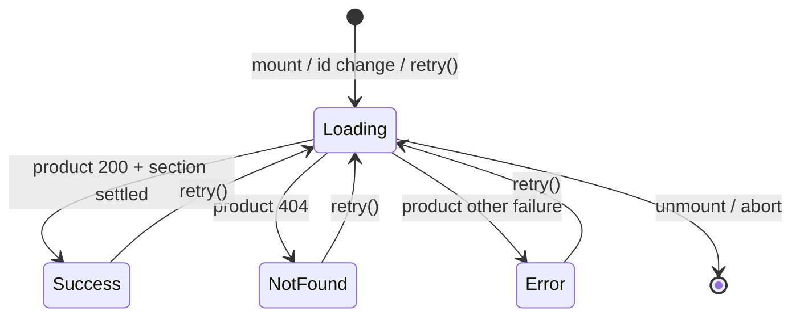

# Implementation Plan: Product Detail API Integration

**Branch**: `feature/search-and-browse` | **Date**: 2026-11-25 | **Spec**: [spec.md](spec.md)  
**Input**: Feature specification from `specs/002-product-detail-api/spec.md`  
**Scope**: Frontend only (React + Vite)

---

## Summary

Replace the mock data in `src/features/customer/product-detail/` with backend data from the four public catalog/review/recommendation endpoints in `docs/openapi.json`. Add a feature-local API helper (`productDetailApi.js`) and hook (`useProductDetail.js`) that use the shared client with `auth: false`, map responses into the exact shapes the existing components consume, render a similar-products section with the existing card design, and expose loading, 404, out-of-stock, empty-specification, no-rating and error states. Preserve the current visual design of existing sections; keep only the enumerated mock fallbacks with `TODO`, use an empty state when the API has no specifications, handle `null averageRating`, and refresh short-lived signed image URLs through retry. Exported mappers are covered by Node `node:test` unit tests.

---

## Technical Context

**Language/Version**: JavaScript (ES modules), Node.js 22+ per constitution; React 19  
**Primary Dependencies**: Vite 8, React 19, `react-router-dom` 7, `@tanstack/react-query` 5 (available but not required for this feature), `@tabler/icons-react` 3, ESLint 10  
**Storage**: None. Frontend-only; backend owns all persistent data.  
**Testing**: Node's built-in `node:test` runner for exported mapper functions in `productDetailApi.js` (e.g. `tests/productDetailApi.test.js` via `node --test tests/productDetailApi.test.js`); no new dependency, no `npm test` script and no component-test framework. Quality gates also include `npm run lint`, `npm run build`, and the manual UI scenarios in [quickstart.md](quickstart.md).  
**Target Platform**: Modern browsers via Vite SPA; dev server `npm run dev:api` with `VITE_API_URL`  
**Project Type**: Frontend web application (single-page React app)  
**Performance Goals**: Exactly four parallel reads per product ID per load; re-renders MUST NOT re-call endpoints; abort stale requests on unmount/ID change; explicit retry obtains fresh signed URLs.  
**Constraints**: All requests through `src/api/client.js` with `auth: false`; no hardcoded URLs; no new runtime dependencies; no redesign of existing sections (the new similar-products section reuses card design); enumerated mock fallbacks carry `TODO`; empty specifications use an empty state; `null averageRating` uses a no-rating state; signed URLs are not cached beyond five minutes.  
**Scale/Scope**: One product detail feature folder; four existing components, page, a similar-products section and mapper tests; no shared `src/api/`, `src/hooks/`, or `src/components/` changes required.

All items discovered during research are resolved in [research.md](research.md); no `NEEDS CLARIFICATION` remain. Where later decisions in `spec.md` and this plan differ from earlier artifacts, `spec.md` and `plan.md` are authoritative.

---

## Constitution Check

*GATE: Checked before Phase 0 research and re-checked after Phase 1 design.*

| Constitution Rule | Status | Evidence / Mitigation |
|---|---|---|
| **I. API Contract First** | PASS | Four operations come from `docs/openapi.json`. `productDetailApi.js` calls `api.get(path, params, { auth: false, signal })`; no `fetch` or URL literals in feature code. Missing fields stay mock with `TODO` instead of guessed contract fields. |
| **II. Feature-Domain Structure** | PASS | New files, including the similar-products section, live in `src/features/customer/product-detail/` and reuse existing card design. `src/pages/Customer/ProductPage.jsx` remains a thin wrapper; no shared folders are modified. |
| **III. Quality Gates** | PASS (design) | Implementation must run `npm run lint` and `npm run build` with zero warnings; exported mappers must have passing `node:test` unit tests via `node --test tests/productDetailApi.test.js` with no new dependency. Manual UI verification remains recorded in [quickstart.md](quickstart.md). |
| **IV. Component and Naming Discipline** | PASS | `productDetailApi.js` and `useProductDetail.js` follow `.js`/`use` naming rules; existing `PascalCase.jsx` components and CSS files are retained. New state styles are added to the existing `ProductDetailPage.css`. |
| **V. Small, Reviewed Changes** | PASS | Work is scoped to one feature and its route page on `feature/search-and-browse`; no new dependencies, no commits to `main`, PR must include screenshots and verification notes. |

No violations; no complexity-tracking justifications are required.

---

## Project Structure

### Documentation (this feature)

```text
specs/002-product-detail-api/
├── spec.md                      # User stories and requirements
├── plan.md                      # This implementation plan
├── research.md                  # Phase 0 research and decisions
├── data-model.md                # Phase 1 view models and state model
├── quickstart.md                # Manual validation guide
└── contracts/
    ├── product-detail-api.md    # Backend endpoint contract
    └── frontend-module.md       # API helper, hook and component props contract
```

### Source Code (repository root)

```text
src/
├── api/
│   └── client.js                         # Shared client (unchanged)
├── pages/Customer/
│   └── ProductPage.jsx                   # Thin route wrapper (unchanged)
└── features/customer/product-detail/
    ├── productDetailApi.js               # NEW: endpoint calls + exported pure mappers
    ├── useProductDetail.js               # NEW: loading/404/error/retry state
    ├── ProductDetailPage.jsx             # Wire hook, route ID, UI states and similar section
    ├── ProductDetailPage.css             # Add minimal state styles only
    ├── ProductHero.jsx                   # Accept mapped product props; out-of-stock state
    ├── ProductHighlights.jsx             # Accept mapped highlights props
    ├── ProductSpecifications.jsx         # Accept mapped specs; render empty state when none
    ├── ProductReviews.jsx                # Accept mapped reviews/summary/distribution props
    └── SimilarProducts.jsx               # NEW: similar-products section using existing card design

tests/
└── productDetailApi.test.js              # NEW: node:test unit tests for exported mappers
```

Unchanged supporting files: `src/mocks/product-detail.js` (fallback source), component CSS files for the four sections, the existing card styles reused by `SimilarProducts.jsx`, and `src/App.jsx` (route `/products/:id` already exists).

**Structure Decision**: Keep all new logic inside the existing `customer/product-detail` feature folder per Constitution Principle II and `docs/CONVENTIONS.md`. Do not modify shared folders.

---

## Phase 0 — Research Conclusions

1. **Contract location**: `docs/api/openapi.json` is absent; use `docs/openapi.json`. All four operations explicitly declare `security: []`, so `auth: false` is required even when a token exists.
2. **Failure isolation**: Product detail is required; reviews, rating summary, and similar products are supplementary. `Promise.allSettled` keeps a partial failure from hiding the product.
3. **Hook style**: Use plain `useState`/`useEffect` with an `AbortController`, matching `useCategory.js`, instead of introducing React Query into this feature.
4. **Missing data**: No original/list price, no per-star distribution, no purchased/with-photo counters, no review title, no guaranteed color option and no highlights endpoint exist. Keep exactly those mocks with explicit `TODO` comments. Empty `technicalSpecifications` renders an empty state, not mock specifications; `null averageRating` renders a no-rating message; signed image URLs expire within five minutes and are refreshed via `retry()`.
5. **Verification**: Exported mappers are unit-tested with Node's built-in `node:test`; lint/build plus manual UI scenarios remain the end-to-end quality gates.

---

## Phase 1 — Design

### Endpoint Calls

```text
GET /api/products/{id}
GET /api/products/{id}/reviews?page=0&size=20&sort=createdAt,desc
GET /api/products/{id}/rating-summary
GET /api/products/{id}/similar?limit=10
```

For each product ID load, all four calls run in parallel exactly once with `auth: false` and the same `AbortSignal`. Re-renders MUST NOT issue new calls; only an ID change or an explicit `retry()` starts a new load, which also refreshes signed image URLs.

### Mapping contract

| API data | Component prop | Transformation |
|---|---|---|
| `ProductDetail.name` | `ProductHero.product.name` | Direct |
| Selected `VariantSummary.sku` | `product.sku` | Direct fallback to first variant |
| `primaryImageUrl` / `images[0].url` | `product.image` | First non-null signed URL; short-lived, refreshed via `retry()`, broken image degrades to alt/placeholder |
| `VariantSummary.options.storage` | `product.options[].storage` | Known key lookup with fallback |
| `sellingPrice.amount` | `product.options[].price` | `Number(amount)`, formatting only |
| No API field | `product.options[].originalPrice` | Mock by storage/index — **TODO** |
| `availability.availableQuantity` / `status` | `product.inventory`, `inStock` | `IN_STOCK && quantity > 0` |
| No color option returned | `product.color` | Mock fallback — **TODO** |
| `technicalSpecifications` | `ProductSpecifications.specifications` | Object → `[label, value]` groups; empty object renders an explicit empty state, never mock specs |
| `highlights` mock | `ProductHighlights.highlights` | Unchanged — **TODO** |
| `ReviewPage.items` | `ProductReviews.reviews` | Map author/comment/time/images; title derived — **TODO**; null `finalUrl` images omitted, signed URLs short-lived |
| `ProductRatingSummary.reviewCount` | `ProductReviews.summary.count` | Formatted count |
| `ProductRatingSummary.averageRating` | `ProductReviews.summary.score` | Formatted score; `null` → "Chưa có đánh giá", never `0`/`NaN` |
| No API counters | `summary.purchased`, `summary.withPhotos` | Mock — **TODO** |
| Static distribution | `ProductReviews.distribution` | Unchanged — **TODO** |
| `Recommendations.items` | `similarProducts` + `SimilarProducts` section | ProductCard-compatible objects rendered with the existing card design |

Mocked fields covered by FR-004 (all require `TODO`): `originalPrice`, `highlights`, `color` fallback, derived review `title`, `summary.purchased`, `summary.withPhotos`, star distribution. No other field uses mock data; empty specifications use an empty state.

Detailed field-level rules are in [data-model.md](data-model.md) and [contracts/frontend-module.md](contracts/frontend-module.md).

### State flow



`sectionErrors` is orthogonal to `data`: a failed reviews/rating/similar request produces an inline message while the product remains visible.

### UI state handling

- `ProductDetailPage` reads `useParams().id`, calls `useProductDetail(id)`, and short-circuits to loading/not-found/error markup using `role="status"` / `role="alert"`.
- Error and 404 states include a "Thử lại" or "Back to products" affordance; error copy follows existing Vietnamese patterns.
- `ProductHero` receives `inStock` and disables the stepper, "MUA NGAY", and "Thêm vào giỏ hàng" when false, replacing the stock line with "Hết hàng".
- `ProductSpecifications` renders an explicit empty message when the selected variant has no `technicalSpecifications`; it never falls back to mock specs.
- `ProductReviews` renders "Chưa có đánh giá" when `averageRating` is `null`; it never coerces the value to `0` or `NaN`.
- `SimilarProducts` renders the mapped `similarProducts` list with the existing card design; a failed similar request shows an inline section error without hiding the product.
- Signed product/review/similar image URLs are consumed as short-lived values; `retry()` refreshes them and broken images show alt/placeholder text.
- All success-path JSX, class names, and CSS for the four existing sections remain unchanged; the new section reuses existing card styles.

### Post-design constitution re-check

No new shared-module changes, dependencies, or contract guesses were introduced. All five principles remain PASS; see the Constitution Check table above.

---

## Delivery Notes for Phase 2 (tasks.md)

1. Implement `productDetailApi.js` with endpoint functions, exported pure mappers, `allSettled` aggregation, the exact TODO-marked mock fallbacks, empty-spec handling, null-rating handling and short-lived signed-URL handling.
2. Implement `useProductDetail.js` with abort/race safety, exactly one call per endpoint per ID load, 404/error/section errors, and a `retry()` that refreshes signed URLs.
3. Convert the four section components to props; add `SimilarProducts.jsx` using the existing card design; wire `ProductDetailPage` and minimal CSS states.
4. Add `tests/productDetailApi.test.js` with `node:test` unit tests for every exported mapper; run `node --test tests/productDetailApi.test.js`.
5. Run `npm run lint` and `npm run build`; complete the manual verification table in [quickstart.md](quickstart.md).

`tasks.md` is intentionally not created by this plan command.
